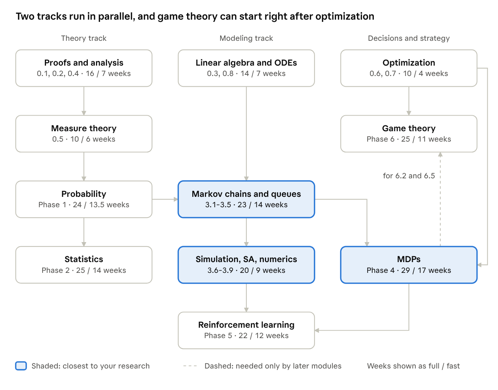
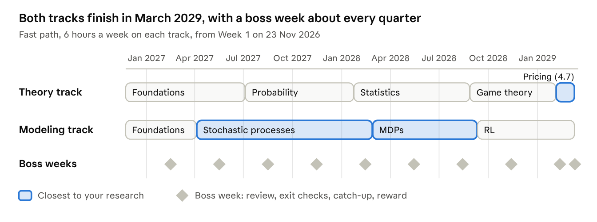

# Probability → Stochastic Processes → MDPs → RL → Game Theory: Research-Aligned Curriculum

Roadmap as of 16 Nov 2026 · live version: https://claude.ai/artifact/YQgvydscMpbENNTDQYPLhk

## Read this first

Your direction is right, but the plan as stated has four gaps: no measure theory, no optimization, a too-serial order, and no way to skip what you already know.

**What checks out.** [Bilkent IE 523](https://catalog.bilkent.edu.tr/course/c13523.html) is real: "Probabilistic Analysis", a graduate IE course. Its catalog runs from the axioms through conditional expectation, transforms, convergence modes, the CLT and the Poisson theorem. It does not cover statistics, so statistics is its own phase here.

**What I changed, and why**

- **Added measure theory (0.5).** IE 523's "axiomatic construction" and conditional expectation are measure-theoretic; real analysis alone does not get you there.
- **Added optimization (0.6).** LP duality and convexity underpin the MDP linear program, the minimax theorem and policy-gradient methods.
- **Added ODEs and transforms (0.8); PDEs optional (0.9).** ODEs run CTMCs and stochastic approximation, and Laplace transforms are the workhorse of queueing. Fourier is mostly covered by characteristic functions.
- **Added numerical methods for Markov chains (3.9) and revenue management and dynamic pricing (4.7); optimal control optional (4.8).** Both core additions sit directly on your taxi work: the solvers you run and the prices you set.
- **Added stochastic approximation (3.7).** It is the proof engine behind Q-learning and TD, and the theory under SPSA, which you already use.
- **Added queueing, matrix-analytic methods and simulation (3.4–3.6).** These are your research toolkit; generic stochastic-process courses only skim them.
- **Dropped axiomatic set theory.** ZFC and ordinals do not pay off here. Naive sets, functions and countability take 1–3 weeks inside 0.1.
- **Made it parallel, not serial.** MDPs need discrete-time chains and optimization, not all of Phase 3. Game theory needs optimization and fixed points, not RL.

**Be realistic about size.** Done in full, this is about 14 graduate courses: roughly 220 weeks at 12 hours a week. You have already taken graduate stochastic processes, RL and game-theory courses, so the placement diagnostic should cut that to about 115 weeks. The research-core path (about 60 weeks) is the subset that feeds your taxi-dispatch work directly.

**How to read the rest.** Each phase has a module table with topics, main text, problem source and weeks (full / fast). Problem sets are generated module by module in this project, in the format fixed below.

## Dependency map and timeline

Run two tracks at once: theory (analysis, measure, probability, statistics) and modeling (linear algebra, chains and queues, simulation, RL). Game theory can start as soon as optimization is done.

Phase 3 needs only elementary probability (1.1) to start; its measure-theoretic proofs wait until Phase 1 catches up. Split the 12 hours evenly: 6 on each track.

| Path | What it covers | Weeks at 12 h/week | Choose it when |
| --- | --- | --- | --- |
| Research core | 0.5, 0.8, 1.4–1.6, 2.4, 2.7, 3.3–3.7, 3.9, 4.3, 4.4, 4.6, 4.7, 5.2, 5.4, 6.5 | about 60 | Thesis deadlines come first |
| Fast | All modules, with known material in problems-only mode after the diagnostic | about 115 | Your default, given prior coursework |
| Full | All 51 modules at full depth | about 220 | Time is not the constraint |

**Dates:** the week-by-week plan is in "Schedule at a glance" below and in your [study app](https://claude.ai/artifact/646yyG8GEYHXpB4VCX5fKS).

## How every module works

Every module goes intuition first, then rigor: a plain-words story, a picture, the exact definitions and proofs, problems, a code lab, and a closed-book exit check.

1. **Story (15 minutes).** What problem does this topic solve? Tell it with the taxi stand.
2. **Picture.** Sketch it before writing a formula: a sample path, a state diagram, a histogram.
3. **Precise version.** Definitions and theorems; try each proof yourself before reading it.
4. **Practice.** The problem set, starting with the intuition questions.
5. **Teach it back.** Explain the big idea in five minutes to an imaginary first-year student; the gaps show up fast.

My problem sets and solutions follow the same order: plain words first, then the rigorous argument.

**Weekly rhythm at 12 hours**

| Block | Hours | What you do |
| --- | --- | --- |
| Read and reprove | 4 | Story and sketch first, then definitions and theorems; attempt each proof before reading it |
| Problem set | 5 | Tiers I, A, B, C and T below, written up in LaTeX |
| Code lab | 2 | Tier D: simulate or compute what the theorems claim |
| Review | 1 | Spaced recall of definitions and theorems; update the error log |

**Problem-set format: 20–25 problems per module**

| Tier | Count | Purpose | Example from Module 1.4 |
| --- | --- | --- | --- |
| I — Intuition | 2–3 | Explain in plain words, sketch, or predict before computing | Without calculating: does the CLT tell you how the longest of n passenger waits behaves? Why not? |
| A — Drill | 6–8 | Fluency with computations and standard results | Find the limit in distribution of n·min(U1,…,Un) for i.i.d. Uniform(0,1) |
| B — Proof | 6–8 | Prove or disprove; build counterexamples | Show convergence in probability implies a.s. convergence along a subsequence |
| C — Engineering | 3–5 | Model a real system and get a number | Bound the chance a 30-minute block sees more than 1.5× its mean taxi arrivals |
| D — Code lab | 1–2 | Check a theorem numerically and see where it strains | Simulate the CLT for Exponential vs Pareto(α = 2.5) sums; plot Kolmogorov distance against n |
| T — Taxi thread | 1 | One step of the running airport case study | See "Research thread" below |

**Exit check.** A 3-hour closed-book test per module, from unseen problems. Score 70% or more to move on; otherwise redo the weakest tier.

**Hygiene.** Keep all write-ups and code in one Git repo. Log every error with its cause: missing definition, algebra slip, or wrong theorem. Re-solve logged problems two weeks later.

**How the problem sets arrive.** Ask in this project for a module by number, for example "PS 1.4". Each module arrives in the study app, with hints and solutions you reveal one at a time, and as a PDF with hints and solutions at the back.

## Rewards: XP, levels and badges

Every piece of finished work earns XP, XP raises your level, and each level unlocks a real reward you choose in advance. Your [Probability Study Quest](https://claude.ai/artifact/646yyG8GEYHXpB4VCX5fKS) app adds it all up: mark work done, log hours, and your level and next reward update themselves.

**How you earn XP**

| Action | XP |
| --- | --- |
| Placement diagnostic sent for grading | 100 |
| Problem set finished, every tier attempted | 100 |
| Code lab done | 50 |
| Exit check passed at 70% or more | 150 |
| Exit check at 85% or more | +50 bonus |
| Teach-back: explain the module in a 5-minute video, blog post or whiteboard session | 100 |
| Taxi-thread step (one per phase) | 150 |
| Study week with 10 or more hours logged | 20 |
| Boss week cleared: every exit check of that block passed | 300 |

**Levels.** At the planned pace you level up roughly every three months. These are starting rewards; change them on the app's Rewards screen before Week 1, because choosing in advance is what makes them work.

| Level | Title | XP needed | Reward |
| --- | --- | --- | --- |
| 1 | Set Builder | 0 | Starting line |
| 2 | Epsilon Hunter | 750 | Movie or F1 race night |
| 3 | Measure Keeper | 2,000 | A book you want that is not a textbook |
| 4 | Almost Surely | 3,750 | New MMA or sports gear |
| 5 | Queue Whisperer | 6,000 | A day trip |
| 6 | Unbiased Estimator | 8,500 | Cross one item off your wishlist |
| 7 | Bellman's Apprentice | 11,000 | Tickets to a match, concert or show |
| 8 | Policy Optimizer | 13,500 | A weekend trip |
| 9 | Equilibrium Seeker | 16,500 | Upgrade something you use every day |
| 10 | Grandmaster of Uncertainty | 20,000 | The big one: a Northeast India trip |

**Badges** (one-off bonuses)

- **First Proof** (50 XP): first Tier B problem solved with no hints.
- **Counterexample Collector** (100 XP): 10 counterexamples built.
- **On a Roll / Iron Habit / Half-Year Machine** (100 / 300 / 600 XP): 4, 12 and 26 weeks in a row with 10+ hours.
- **Simulation Agrees** (50 XP): a code-lab result lands inside its theoretical confidence interval.
- **Bug Hunter** (100 XP): find a real error in a textbook or in one of my problem sets.
- **No-Hint Hero** (150 XP): a whole problem set without opening the hints.
- **Taxi Architect** (500 XP): all seven taxi-thread steps done.

**House rules.** XP counts only for work you checked honestly, and exit checks stay closed-book. A missed week costs only the streak; catch up in the next boss week. Claim each reward within a week of unlocking it, so effort and payoff stay linked.

## Schedule at a glance

Start Monday 23 November 2026 with 6 hours a week on each track. The fast path ends around 18 March 2029: 121 weeks, including ten boss weeks.

Week 0 (16–22 November) is the placement diagnostic. A boss week follows every 12 study weeks, plus a final one: no new material, only review, that block's exit checks, catch-up and your reward. The [study app](https://claude.ai/artifact/646yyG8GEYHXpB4VCX5fKS) shows every week with its two modules and lets you log hours.

**If you fall behind.** Use the next boss week to catch up. If you slip two blocks in a row, finish that phase with only its research-core modules, which the app's Modules screen marks.

**After the diagnostic** I will re-plan: phases you pass move to faster modes, and every later date moves earlier.

## Placement diagnostic

Take one block per phase: 60 minutes, closed book. Solve 3 of 4 cleanly and that phase runs in fast mode (problems first, skim the reading).

**Phase 0 — foundations**

1. Prove that a countable union of countable sets is countable. Where does the argument use a choice?
2. Let f\_n(x) = x^n on \[0,1\]. Does f\_n converge uniformly? Decide whether lim ∫ f\_n = ∫ lim f\_n and name the theorem that justifies it.
3. Let Q be the generator of an irreducible finite-state CTMC. Prove 0 is a simple eigenvalue and every other eigenvalue has negative real part.
4. Derive Fatou's lemma from the monotone convergence theorem. Give an example where its inequality is strict.

**Phase 1 — probability**

1. Let X1, X2, … be i.i.d. with E|X1| finite. Prove max(|X1|, …, |Xn|)/n → 0 almost surely.
2. Construct a sequence that converges in probability but not almost surely. Prove some subsequence converges almost surely.
3. Define E\[X | G\] for integrable X, prove it exists via Radon–Nikodym, and prove the tower property.
4. Prove Binomial(n, λ/n) converges in distribution to Poisson(λ) using characteristic functions.

**Phase 2 — statistics**

1. X1, …, Xn are i.i.d. Exponential(λ). Find the MLE of λ, its bias, the UMVUE, and an exact 95% confidence interval.
2. For Poisson counts, find the most powerful test of λ = λ0 against λ = λ1 > λ0. Show it is uniformly most powerful for λ > λ0.
3. From n interarrival times and n service times of an M/M/1 queue, give the asymptotic distribution of the MLE of ρ = λ/μ via the delta method.
4. With a Gamma prior on a Poisson rate, derive the posterior and the posterior predictive distribution of next hour's count.

**Phase 3 — stochastic processes**

1. Taxis arrive Poisson(α) to a buffer of size K; passengers arrive Poisson(β) and leave at once if no taxi waits. Find the stationary distribution of the taxi count.
2. Derive the Pollaczek–Khinchine mean waiting time for M/G/1 using the mean residual service time.
3. Prove P(t) = Σ e^(−Λt) (Λt)^n / n! · P^n with P = I + Q/Λ. Bound the error of truncating after N terms.
4. State the Robbins–Monro step-size conditions. Explain why SPSA needs two cost evaluations per step whatever the dimension.

**Phase 4 — MDPs**

1. Prove the discounted Bellman operator is a γ-contraction in the sup norm, and deduce that value iteration converges.
2. Write the primal LP of a finite discounted MDP and its dual. Interpret the dual variables as discounted occupation measures.
3. Admission control to an M/M/1 queue, reward R per admitted customer, holding cost h per unit time: prove the optimal policy is a threshold.
4. State the average-cost optimality equation and a condition, such as unichain, under which it has a solution.

**Phase 5 — reinforcement learning**

1. State conditions under which tabular Q-learning converges almost surely. Sketch the stochastic-approximation proof.
2. Derive the policy gradient theorem for the discounted objective.
3. Explain the deadly triad and describe Baird's counterexample.
4. Derive the O(log n) regret bound of UCB1 for a K-armed bandit.

**Phase 6 — game theory**

1. Prove von Neumann's minimax theorem for finite zero-sum games using LP duality.
2. Prove a finite game has a mixed Nash equilibrium, using Brouwer's or Kakutani's fixed-point theorem.
3. In Naor's observable M/M/1 model, show the individually optimal joining threshold is at least the socially optimal one. Find the toll that aligns them.
4. Show a Wardrop equilibrium solves Beckmann's convex program, and construct Braess's paradox.

Send me your answers (photos or LaTeX). I will grade them and set your starting module in each phase.

## Phase 0 — Mathematical foundations

Phase 0 builds the proof and analysis machinery: 53 weeks in full, about 24 in fast mode. Measure theory (0.5) is the real gate; most of the rest will be review for you.

**In plain words.** Probability keeps talking about limits, sizes of sets, and systems that change over time. Analysis makes "limit" precise, measure theory makes "size" precise even for strange infinite sets, and linear algebra with ODEs describes how a system's state moves. Learn them once and every later proof gets shorter.

| Module | Core topics | Read | Problems from | Weeks (full / fast) |
| --- | --- | --- | --- | --- |
| 0.1 Proofs, sets, functions | Logic, induction, set algebra, images and preimages, relations, equivalence classes, cardinality, Cantor's theorem, countable unions | Velleman, *How to Prove It* (3rd ed.) | Velleman; Hammack, *Book of Proof* (free) | 3 / 1 |
| 0.2 Real analysis | Completeness, sequences, limsup and liminf, series, continuity, uniform convergence, compactness, metric spaces, Riemann integral, interchanging limits | Abbott, *Understanding Analysis* (2nd ed.) | Abbott; Rudin, *Principles of Mathematical Analysis* ch. 1–7 | 10 / 5 |
| 0.3 Linear algebra and matrix analysis | Vector spaces, eigenvalues, Jordan form, spectral theorem, SVD, matrix norms, matrix exponential, nonnegative matrices, Perron–Frobenius, M-matrices, Kronecker products | Axler, *Linear Algebra Done Right* (4th ed., free) | Axler; Horn and Johnson, *Matrix Analysis* (2nd ed.) | 8 / 4 |
| 0.4 Multivariable calculus | Derivatives in R^n, chain rule, inverse and implicit function theorems, change of variables with Jacobians | Rudin ch. 9–10 or Munkres, *Analysis on Manifolds* | Same | 3 / 1 |
| 0.5 Measure theory and integration | σ-algebras, π–λ theorem, Carathéodory extension, Lebesgue measure, measurable functions, MCT, Fatou, DCT, Lp spaces, product measures, Fubini–Tonelli, Radon–Nikodym | Axler, *Measure, Integration & Real Analysis* (free) or Tao, *An Introduction to Measure Theory* | Axler; Folland, *Real Analysis* ch. 1–3 | 10 / 6 |
| 0.6 Optimization | Convex sets and functions, LP duality, KKT conditions, Lagrangian duality, subgradients, SGD convergence | Boyd and Vandenberghe, *Convex Optimization* (free) | Boyd and Vandenberghe; Bertsimas and Tsitsiklis, *Introduction to Linear Optimization* | 6 / 2 |
| 0.7 Functional analysis (light) | Normed, Banach and Hilbert spaces, Banach fixed-point theorem, orthogonal projection, bounded operators | Kreyszig, *Introductory Functional Analysis with Applications* ch. 1–5 | Kreyszig | 4 / 2 |
| 0.8 ODEs and transforms | Linear systems x′ = Ax and the matrix exponential, existence and uniqueness (Picard), equilibria, linearization, Lyapunov functions, LaSalle; Laplace and Laplace–Stieltjes transforms, convolution, inversion including numerical inversion; Fourier transform and the convolution theorem; z-transforms | Hirsch, Smale and Devaney, *Differential Equations, Dynamical Systems, and an Introduction to Chaos* (3rd ed.); Schiff, *The Laplace Transform*; Stein and Shakarchi, *Fourier Analysis* | Hirsch, Smale and Devaney; Schiff | 6 / 3 |
| 0.9 PDE primer (optional) | Heat and transport equations, method of characteristics, Kolmogorov backward and Fokker–Planck equations, the HJB equation in plain terms | Strauss, *Partial Differential Equations: An Introduction* (2nd ed.) | Strauss | 3 / 0 |

**Engineering touch, module by module**

- **0.1** Preimages are exactly what "measurable" means later; countability is why probability is only countably additive.
- **0.2** Uniform convergence decides when you may truncate the uniformization series or differentiate under an integral.
- **0.3** CTMC generators are M-matrices; stationary vectors come from Perron–Frobenius; QBD generators are block-tridiagonal Kronecker sums.
- **0.4** Jacobians give the density of transformed random variables, such as a passenger's wait as a function of two arrival times.
- **0.5** Likelihood-ratio gradient estimators are Radon–Nikodym derivatives; Fubini justifies swapping expectation and time integrals in cost functions.
- **0.6** The dispatch cost you minimize per time block is a constrained program; its dual variables are shadow prices, the starting point for tolls and surge pricing.
- **0.7** Bellman operators are contractions on a Banach space; conditional expectation is a projection in L2.
- **0.8** Kolmogorov's equations P′(t) = P(t)Q are a linear ODE system with solution P(t) = e^(Qt). Stochastic approximation (3.7) and fluid limits (3.4) are judged by ODE stability. Laplace transforms give M/G/1 waiting-time distributions and solve renewal equations.
- **0.9** Needed only before 3.8 (diffusion approximations) or 6.6 (mean-field games), where Fokker–Planck and HJB equations appear. Skip it otherwise.

**Do you need ODEs, PDEs, Laplace and Fourier?** Yes to ODEs and Laplace, mostly-already-covered for Fourier, optional for PDEs.

| Subject | Verdict | Where it shows up |
| --- | --- | --- |
| ODEs | Needed: linear systems and stability, not a full course | Kolmogorov equations for CTMCs (3.3), the ODE method for stochastic approximation (3.7), fluid limits of queues (3.4) |
| Laplace transform | Needed | M/G/1 waiting-time and busy-period distributions (3.4), renewal equations (3.2), transient CTMC analysis (3.3) |
| Fourier transform | Mostly covered already | The characteristic function in 1.3 is a Fourier transform; 0.8 adds the convolution theorem and inversion |
| PDEs | Optional | Only diffusion approximations (3.8) and mean-field games (6.6) |

## Phase 1 — Rigorous probability theory

Phase 1 covers every topic in Bilkent IE 523, done measure-theoretically, plus martingales and concentration inequalities, which IE 523 omits but RL theory needs. It takes 24 weeks in full, about 13.5 in fast mode.

**In plain words.** A probability model is a list of every possible day at the airport plus a rule saying how likely each group of days is; measure theory keeps that rule consistent. Two results carry the subject: averages settle down to the true mean (law of large numbers), and the leftover wobble looks like a bell curve (central limit theorem).

**Lecture spine.** The closest free match to "rigor with an engineering touch" is Krishna Jagannathan's NPTEL course [Probability Foundations for Electrical Engineers](https://onlinecourses.nptel.ac.in/noc25_ee95/preview) (IIT Madras). It runs from countability and probability spaces through Carathéodory, expectation as an integral, transforms, concentration and limit theorems, with [free lecture notes](https://www.ee.iitm.ac.in/~krishnaj/ee5110notes.htm). Watch it alongside 1.2–1.4.

| Module | Core topics | Read | Problems from | Weeks (full / fast) |
| --- | --- | --- | --- | --- |
| 1.1 Elementary probability (calculus-based) | Counting, conditioning, Bayes, discrete and continuous random variables, joint and derived distributions, order statistics, transforms, informal limit theorems | Bertsekas and Tsitsiklis, *Introduction to Probability* (2nd ed.) | MIT 6.041 problem sets; Blitzstein and Hwang, *Introduction to Probability* (2nd ed., free) | 4 / 1 |
| 1.2 Probability spaces and random variables | Axioms, Carathéodory, Lebesgue measure on \[0,1\], infinite coin toss, independence of σ-algebras, Borel–Cantelli, Kolmogorov 0–1 law, discrete, continuous and singular distributions | Jagannathan notes, modules 0–2; Rosenthal, *A First Look at Rigorous Probability Theory* (2nd ed.) | Grimmett and Stirzaker, *One Thousand Exercises in Probability* (3rd ed.) | 4 / 3 |
| 1.3 Expectation and transforms | Expectation as a Lebesgue integral, Markov, Chebyshev, Jensen, Hölder, Minkowski, Cauchy–Schwarz, transformations with Jacobians, PGF, MGF, characteristic functions, inversion and uniqueness, multivariate normal | Grimmett and Stirzaker, *Probability and Random Processes* (4th ed.) ch. 3–5; Jagannathan notes, modules 3–4 | One Thousand Exercises; Shiryaev, *Problems in Probability* | 4 / 2 |
| 1.4 Convergence and limit theorems | Four modes of convergence, uniform integrability, Skorokhod representation, continuous mapping, Slutsky, WLLN, SLLN, Lévy continuity, Lindeberg–Feller CLT, Poisson limit, delta method, Cramér's theorem | Durrett, *Probability: Theory and Examples* (5th ed.) ch. 2–3; Jagannathan notes, module 5 | Durrett; Shiryaev | 5 / 3 |
| 1.5 Conditional expectation | Definition via Radon–Nikodym, properties, L2 projection, regular conditional distributions, conditional independence | Williams, *Probability with Martingales* ch. 9 | Williams; Durrett | 2 / 1.5 |
| 1.6 Martingales and concentration | Filtrations, stopping times, optional stopping, Doob's inequalities, martingale convergence, UI martingales, Wald's identity, Azuma–Hoeffding, Hoeffding, Bernstein, McDiarmid | Williams ch. 10–14; Vershynin, *High-Dimensional Probability* ch. 2 (free) | Williams; Durrett | 5 / 3 |
|  |  |  |  |  |

**Deeper references, if a topic grabs you:** Billingsley, *Probability and Measure*; Shiryaev, *Probability-1*.

**Engineering touch, module by module**

- **1.1** Reliability of series, parallel and k-out-of-n systems; the probability that a passenger group of size 3 finds a large-enough taxi.
- **1.2** Thinning and superposition: taxi arrivals from several city zones merge into one stream; Borel–Cantelli decides whether the buffer empties infinitely often.
- **1.3** Chernoff bounds on the probability that a time block overflows the taxi buffer.
- **1.4** Monte Carlo error bars from the CLT; why your simulated daily cost averages converge, and how fast.
- **1.5** Expected wait given the current queue state is a conditional expectation, the object every dispatch policy optimizes.
- **1.6** Wald's identity for the number of dispatches until the queue clears; optional stopping for the buffer hitting zero before K.

## Phase 2 — Statistics

IE 523 stops at limit theorems, so statistics is its own phase: 25 weeks in full, about 14 in fast mode. Casella and Berger carries the theory; Wasserman gives breadth; 2.7 points everything at the data your models consume.

**In plain words.** Probability goes from a model to the data it produces; statistics runs backwards, from data to the model. Given a week of logs of taxi arrivals per hour, what is your best guess of the true rate, and how wrong could that guess be?

| Module | Core topics | Read | Problems from | Weeks (full / fast) |
| --- | --- | --- | --- | --- |
| 2.1 Sampling and data reduction | Chi-square, t and F distributions, order statistics, sufficiency, factorization theorem, minimal sufficiency, completeness, exponential families, ancillarity, Basu's theorem | Casella and Berger, *Statistical Inference* (2nd ed.) ch. 5–6 | Casella and Berger | 4 / 2 |
| 2.2 Point estimation | Method of moments, MLE, Bayes estimators, EM algorithm, MSE, Fisher information, Cramér–Rao, Rao–Blackwell, Lehmann–Scheffé | Casella and Berger ch. 7 | Casella and Berger | 4 / 2 |
| 2.3 Hypothesis tests and intervals | Neyman–Pearson, UMP tests, monotone likelihood ratio, likelihood-ratio, Wald and score tests, p-values, multiple testing, pivots, inverting tests | Casella and Berger ch. 8–9 | Casella and Berger | 4 / 2 |
| 2.4 Asymptotic theory | Consistency, asymptotic normality and efficiency of the MLE, delta method, Wilks' theorem, M-estimators | Casella and Berger ch. 10; van der Vaart, *Asymptotic Statistics* (deeper) | Casella and Berger; van der Vaart | 3 / 2 |
| 2.5 Regression and linear models | OLS geometry, Gauss–Markov, inference for coefficients, GLMs including Poisson regression, regularization | Wasserman, *All of Statistics* ch. 13; James et al., *ISLP* (free) | Wasserman; ISLP labs | 3 / 2 |
| 2.6 Bayesian and computational statistics | Priors, conjugacy, hierarchical models, Metropolis–Hastings, Gibbs sampling, bootstrap, kernel density estimation, cross-validation | Wasserman; Gelman et al., *Bayesian Data Analysis* (3rd ed., free) | Wasserman; BDA3 | 4 / 2 |
| 2.7 Input and output analysis for stochastic models | Rate estimation for nonhomogeneous Poisson processes, goodness-of-fit for interarrival times, MLE of a CTMC generator, phase-type fitting by EM, batch means and confidence intervals for simulation output | Law, *Simulation Modeling and Analysis*; Asmussen and Glynn, *Stochastic Simulation* | Law | 3 / 2 |

**Engineering touch, module by module**

- **2.1** Is the count of taxi arrivals in a block sufficient for its rate? For which models does that fail?
- **2.2** MLE and Cramér–Rao bounds for hourly passenger arrival rates from airport logs.
- **2.3** Test whether taxi interarrival times are exponential, or whether a flight bank shifts the rate.
- **2.4** Delta-method error bars on a derived quantity, such as the mean wait 1/(μ − λ), from estimated rates.
- **2.5** Poisson regression of passenger demand on scheduled flight arrivals, hour and weekday.
- **2.6** Bayesian updating of the demand rate for dynamic pricing; bootstrap intervals for policy cost.
- **2.7** Fit the arrival model your CTMC needs, then state confidence intervals for simulated daily cost.

## Phase 3 — Stochastic processes, queues, simulation and stochastic approximation

Phase 3 is where your research lives: Markov chains, Poisson and renewal processes, CTMCs and uniformization, queues and QBDs, then simulation and stochastic approximation. It takes 43 weeks in full, about 23 in fast mode; 3.8 is optional.

**In plain words.** Now randomness unfolds over time. A Markov chain forgets everything except where it is now, so the current taxi count and queue length are all you need to predict the next minute. Queues, QBDs and simulation are tools for computing what such systems do, both in the long run and hour by hour.

**Lecture spine.** MIT OCW 6.262 *Discrete Stochastic Processes* (Gallager), with problem sets, tracks 3.1–3.3 closely.

| Module | Core topics | Read | Problems from | Weeks (full / fast) |
| --- | --- | --- | --- | --- |
| 3.1 Discrete-time Markov chains | Classification, hitting times, stationary distributions, ergodic theorem, reversibility, coupling, mixing times, MCMC convergence | Norris, *Markov Chains* ch. 1; Levin and Peres, *Markov Chains and Mixing Times* (2nd ed., free) | Norris; Levin and Peres | 4 / 2 |
| 3.2 Poisson and renewal processes | Homogeneous, nonhomogeneous, compound and marked Poisson; thinning and superposition; renewal function; key renewal theorem; renewal-reward; regenerative processes; inspection paradox; Little's law | Gallager, *Stochastic Processes: Theory for Applications*; Ross, *Stochastic Processes* (2nd ed.) | Gallager; Ross; One Thousand Exercises | 5 / 3 |
| 3.3 Continuous-time Markov chains | Generators, Kolmogorov equations, explosion, embedded chain, uniformization, birth–death chains, reversibility, transient analysis, phase-type distributions | Norris ch. 2–3; Kulkarni, *Modeling and Analysis of Stochastic Systems* (3rd ed.) | Kulkarni; Norris | 4 / 2 |
| 3.4 Queueing theory | M/M/c/K, Erlang B and C, M/G/1 and Pollaczek–Khinchine, PASTA, Jackson and BCMP networks, time-varying queues (PSA, infinite-server approximations), fluid and diffusion limits, double-ended matching queues | Harchol-Balter, *Performance Modeling and Design of Computer Systems*; Whitt, *Stochastic-Process Limits* (free) | Harchol-Balter; Kulkarni | 6 / 4 |
| 3.5 Matrix-analytic methods | QBDs, matrix-geometric solution, R and G matrices, logarithmic and cyclic reduction, level-dependent QBDs, Markovian arrival processes | Latouche and Ramaswami, *Introduction to Matrix Analytic Methods in Stochastic Modeling*; Neuts, *Matrix-Geometric Solutions in Stochastic Models* | Latouche and Ramaswami; Stewart, *Probability, Markov Chains, Queues, and Simulation* | 4 / 3 |
| 3.6 Simulation and gradient estimation | Random variate generation, discrete-event simulation, common random numbers, control variates, importance sampling, finite differences, SPSA, IPA, likelihood-ratio (score function) gradients | Asmussen and Glynn, *Stochastic Simulation: Algorithms and Analysis*; Spall, *Introduction to Stochastic Search and Optimization* | Asmussen and Glynn; Spall | 4 / 3 |
| 3.7 Stochastic approximation | Robbins–Monro, Kiefer–Wolfowitz, ODE method, step-size conditions, two-timescale and asynchronous SA | Borkar, *Stochastic Approximation: A Dynamical Systems Viewpoint* (2nd ed.); Kushner and Yin, *Stochastic Approximation and Recursive Algorithms and Applications* | Borkar; Kushner and Yin | 4 / 3 |
| 3.8 Brownian motion and stochastic calculus (optional) | Construction of BM, quadratic variation, Itô integral and formula, SDEs, reflected BM for heavy-traffic limits, Girsanov | Le Gall, *Brownian Motion, Martingales, and Stochastic Calculus* | Le Gall; Karatzas and Shreve | 8 / 0 |
| 3.9 Numerical methods for Markov chains | Sparse direct and iterative solvers for stationary distributions (GTH, power, Gauss–Seidel, GMRES), conditioning and error bounds, the matrix exponential (uniformization, Padé, Krylov methods), stiffness and ODE integrators, block methods for QBDs, GPU sparse kernels | Stewart, *Introduction to the Numerical Solution of Markov Chains*; Trefethen and Bau, *Numerical Linear Algebra* | Stewart; Moler and Van Loan, "Nineteen Dubious Ways to Compute the Exponential of a Matrix, Twenty-Five Years Later" | 4 / 3 |

**Engineering touch, module by module**

- **3.1** Mixing-time bounds tell you how long your simulation's warm-up must be.
- **3.2** Nonhomogeneous Poisson arrivals driven by the flight schedule; renewal-reward for long-run cost per taxi.
- **3.3** A uniformization truncation bound you can put in your paper, rather than a fixed number of terms.
- **3.4** The taxi stand as a double-ended queue with passenger impatience; PSA and its failure in fast-changing time blocks.
- **3.5** Your taxi-buffer × passenger-queue model is a QBD: compute R, then check it against your transient solver's long-run limit.
- **3.6** Compare SPSA, IPA and likelihood-ratio gradients of block cost with respect to dispatch parameters; use common random numbers.
- **3.7** Convergence conditions for SPSA and for Adam-like steps on your objective; two-timescale pricing plus dispatch.
- **3.8** Diffusion approximations of the taxi queue in heavy traffic, as a sanity check on large-airport parameters.
- **3.9** Error bounds and theory under the sparse, GPU-accelerated transient solver you already run, and a rule for when uniformization beats an ODE integrator.

## Phase 4 — MDPs and stochastic control

Phase 4 turns your models into decisions: 29 weeks in full, about 17 in fast mode. For you the key modules are average cost, control of queues via uniformization, structural (threshold) results, approximate DP and dynamic pricing.

**In plain words.** Add a decision maker. An MDP asks which action to take in each state so the long-run cost is as small as possible. Bellman's idea: the best plan from now on is the best next move plus the best plan from wherever that move lands you.

**Lecture spine.** MIT OCW 6.231 *Dynamic Programming and Stochastic Control* (Bertsekas) for 4.1–4.3.

| Module | Core topics | Read | Problems from | Weeks (full / fast) |
| --- | --- | --- | --- | --- |
| 4.1 Finite-horizon DP | Principle of optimality, backward induction, inventory problems, optimal stopping, one-step look-ahead rules | Bertsekas, *Dynamic Programming and Optimal Control* Vol. I (4th ed.); Ross, *Introduction to Stochastic Dynamic Programming* | Bertsekas Vol. I; Ross | 3 / 2 |
| 4.2 Discounted infinite horizon | Bellman operator, contraction, value iteration, policy iteration, modified PI, LP formulation, occupation measures | Puterman, *Markov Decision Processes* ch. 6 | Puterman | 3 / 2 |
| 4.3 Average and total cost | Unichain and multichain models, average-cost optimality equation, relative value iteration, vanishing discount, Blackwell optimality | Puterman ch. 8–9; Bertsekas Vol. II (4th ed.) | Puterman; Bertsekas Vol. II | 3 / 2 |
| 4.4 Structure and control of queues | Monotone policies, submodularity, threshold policies, admission, routing and dispatch control, semi-Markov and continuous-time MDPs via uniformization, countable-state conditions | Puterman ch. 11; Sennott, *Stochastic Dynamic Programming and the Control of Queueing Systems* | Sennott; Puterman | 4 / 3 |
| 4.5 Constrained MDPs and POMDPs | Lagrangian methods, constrained occupation-measure LPs, randomized optimal policies, belief-state MDPs | Altman, *Constrained Markov Decision Processes*; Krishnamurthy, *Partially Observed Markov Decision Processes* | Altman; Krishnamurthy | 3 / 1 |
| 4.6 Approximate DP | Value-function approximation, post-decision states, rollout, aggregation, approximate LP | Powell, *Approximate Dynamic Programming* (2nd ed.) or *Reinforcement Learning and Stochastic Optimization*; Bertsekas Vol. II | Powell; Bertsekas | 4 / 3 |
| 4.7 Revenue management and dynamic pricing | Single-product dynamic pricing (Gallego–van Ryzin), intensity control, customer choice models including multinomial logit, network revenue management and bid prices, deterministic LP bounds, pricing while learning demand | Gallego and Topaloglu, *Revenue Management and Pricing Analytics*; Talluri and van Ryzin, *The Theory and Practice of Revenue Management* | Gallego and Topaloglu | 5 / 4 |
| 4.8 Optimal control and fluid models (optional) | Deterministic optimal control, Pontryagin's maximum principle, the HJB equation, fluid models of time-varying queues and their optimal control | Liberzon, *Calculus of Variations and Optimal Control Theory* | Liberzon | 4 / 0 |

**Engineering touch, module by module**

- **4.1** Time-block dispatch and pricing over a day as a finite-horizon problem with 30-minute stages.
- **4.2** Solve a small taxi-release MDP three ways (VI, PI, LP) and check that all three agree.
- **4.3** Long-run average cost per hour is the natural criterion for a stand that runs all day.
- **4.4** Formulate taxi release from the holding lot as a continuous-time MDP, uniformize it, and prove the optimal release rule is a threshold in the passenger queue.
- **4.5** Minimize taxi idling subject to a cap on the passenger-wait or blocking probability.
- **4.6** City-wide repositioning is too large for exact DP; Powell-style ADP with post-decision states is the standard route.
- **4.7** Time-varying prices against random demand: the theory under surge pricing at the stand.
- **4.8** Smooth fluid approximations of the full-day dispatch problem, solved with ODE methods.

## Phase 5 — Reinforcement learning

You have already taken a graduate RL course, so Phase 5 is about theory (convergence proofs built on 3.7) and scale (deep RL for queueing networks and fleets). It takes 22 weeks in full, about 12 in fast mode.

**In plain words.** RL solves the same problem when you cannot write the model down, by learning from experience or from a simulator. Its convergence proofs reuse Phase 3's stochastic approximation: many small noisy steps that average out to the right answer.

| Module | Core topics | Read | Problems from | Weeks (full / fast) |
| --- | --- | --- | --- | --- |
| 5.1 Tabular foundations (review) | Monte Carlo, TD(λ), SARSA, Q-learning, eligibility traces, exploration | Sutton and Barto, *Reinforcement Learning: An Introduction* (2nd ed., free) | Sutton and Barto | 3 / 1 |
| 5.2 Convergence theory | Q-learning and TD as stochastic approximation, linear function approximation (Tsitsiklis–Van Roy), deadly triad, gradient-TD | Bertsekas and Tsitsiklis, *Neuro-Dynamic Programming*; Szepesvári, *Algorithms for Reinforcement Learning* (free); Meyn, *Control Systems and Reinforcement Learning* | Meyn; Bertsekas and Tsitsiklis | 4 / 3 |
| 5.3 Bandits and exploration | UCB, Thompson sampling, regret lower bounds, linear and contextual bandits, bandits for pricing | Lattimore and Szepesvári, *Bandit Algorithms* (free) | Lattimore and Szepesvári | 4 / 2 |
| 5.4 Policy gradient and actor–critic | Policy gradient theorem, baselines and variance reduction, natural policy gradient, TRPO and PPO, two-timescale actor–critic convergence | Agarwal, Jiang, Kakade and Sun, *Reinforcement Learning: Theory and Algorithms* (free); Konda and Tsitsiklis on actor–critic | AJKS | 4 / 3 |
| 5.5 Sample complexity (optional) | PAC bounds, generative-model complexity, linear MDPs, offline RL basics | AJKS | AJKS | 3 / 0 |
| 5.6 Deep RL for operations | DQN and PPO in practice, RL for queueing networks, ride-hailing dispatch and repositioning, multi-agent RL | Dai and Gluzman, "Queueing Network Controls via Deep Reinforcement Learning" (*Stochastic Systems*, 2022); Qin et al., "Ride-Hailing Order Dispatching at DiDi via Reinforcement Learning" (*INFORMS J. Applied Analytics*, 2020); Lin et al., "Efficient Large-Scale Fleet Management via Multi-Agent Deep RL" (KDD 2018) | Replicate one paper's experiment at small scale | 4 / 3 |

**Engineering touch, module by module**

- **5.1** Q-learning on your taxi-release MDP, checked against the exact solution from 4.2.
- **5.2** Prove your tabular learner converges using the Borkar ODE method from 3.7.
- **5.3** Posted-price surge as a bandit: learn the demand curve while pricing.
- **5.4** PPO for dispatch with a continuous action (release rate) per block.
- **5.5** How many simulated days does a learner need to be ε-optimal on your model?
- **5.6** Average-cost deep RL for the taxi stand, benchmarked against the threshold policy from 4.4.

## Phase 6 — Game theory

Game theory needs optimization (0.6) and fixed-point theorems, not RL, so it can start in parallel with Phases 3–5. It takes 25 weeks in full, about 11 in fast mode; your transport angle is queueing games, congestion and platform pricing.

**In plain words.** Game theory adds many decision makers, each with their own goal. Drivers choose what is best for themselves, not for the airport, so the outcome is an equilibrium that can be worse than a planner's choice. Prices and tolls are the tools that close that gap.

| Module | Core topics | Read | Problems from | Weeks (full / fast) |
| --- | --- | --- | --- | --- |
| 6.1 Strategic and extensive-form games | Dominance, Nash equilibrium, mixed strategies, existence via Brouwer and Kakutani, zero-sum games and minimax via LP duality, correlated equilibrium, subgame perfection, Bayesian games | Maschler, Solan and Zamir, *Game Theory* (2nd ed.); Osborne and Rubinstein, *A Course in Game Theory* (free) | Maschler, Solan and Zamir | 6 / 3 |
| 6.2 Repeated, stochastic and Markov games | Folk theorems, Shapley's stochastic games, Markov perfect equilibrium, minimax-Q and Nash-Q | Maschler, Solan and Zamir; Filar and Vrieze, *Competitive Markov Decision Processes* | Filar and Vrieze | 3 / 2 |
| 6.3 Algorithmic game theory and mechanism design | Computing equilibria, price of anarchy, potential games, no-regret learning, fictitious play, auctions, VCG, Myerson's optimal auction | Roughgarden, *Twenty Lectures on Algorithmic Game Theory*; Nisan et al., *Algorithmic Game Theory* (free) | Roughgarden | 4 / 2 |
| 6.4 Congestion and traffic equilibrium | Wardrop equilibrium, Beckmann formulation, Braess's paradox, price of anarchy for selfish routing, stochastic user equilibrium | Sheffi, *Urban Transportation Networks* (free); Roughgarden, *Selfish Routing and the Price of Anarchy* | Sheffi | 3 / 1 |
| 6.5 Queueing games and platform economics | Naor's observable M/M/1 tolls, unobservable queues, strategic servers, two-sided markets, surge pricing | Hassin and Haviv, *To Queue or Not to Queue*; Hassin, *Rational Queueing*; Banerjee, Johari and Riquelme, "Pricing in Ride-Sharing Platforms: A Queueing-Theoretic Approach" (EC 2015) | Hassin and Haviv | 4 / 3 |
| 6.6 Mean-field games and multi-agent RL (optional) | Mean-field equilibrium, McKean–Vlasov dynamics, MFGs for large driver populations, MARL | Carmona and Delarue, *Probabilistic Theory of Mean Field Games* | Carmona and Delarue | 5 / 0 |

**Engineering touch, module by module**

- **6.1** Two taxi drivers choosing airport versus city as a bimatrix game; compute all equilibria.
- **6.2** Repeated interaction between drivers and the dispatcher; when does cooperation sustain?
- **6.3** Price of anarchy of decentralized driver repositioning against a central planner.
- **6.4** Route choice to the airport under congestion; Braess effects from a new access road.
- **6.5** Drivers decide whether to join the airport taxi queue; compare equilibrium queue length with the social optimum, then design the toll or surge that aligns them.
- **6.6** Thousands of drivers responding to a posted surge, as a mean-field game.

## Research thread: the airport taxi stand

One model grows through every phase, so the Tier T problems add up to a thesis-ready chapter rather than isolated exercises. The base model: taxis arrive from the city, wait in a buffer of size K, and serve passengers who arrive in flight-driven waves.

| Phase | Case-study task | Deliverable |
| --- | --- | --- |
| 0 Foundations | Write the generator of the taxi-buffer × passenger-queue CTMC as a block-tridiagonal matrix; prove irreducibility; identify the QBD blocks | Derivation plus sparse construction code |
| 1 Probability | Prove that merged arrival streams from city zones are Poisson; Chernoff-bound the chance a block overflows the buffer | Proofs plus a simulation check |
| 2 Statistics | Estimate time-varying arrival rates from logs (synthetic first); test exponential interarrivals; confidence intervals on rates | Notebook plus a two-page report |
| 3 Processes | Transient analysis by uniformization with a proven error bound; matrix-geometric stationary solution; SPSA vs IPA vs likelihood-ratio gradients of block cost | Code plus bounds |
| 4 MDPs | Taxi release as a continuous-time MDP; uniformize; prove a threshold policy; solve by LP and relative value iteration; add a wait-time constraint | Optimal policy plus structural proof |
| 5 RL | Q-learning and PPO against the exact policy; average-cost RL; bandit-based surge pricing | Benchmark table |
| 6 Game theory | Drivers' join-or-cruise decision as a Naor-type queueing game; equilibrium vs social optimum; toll or surge that aligns them | Equilibrium analysis plus a mechanism |

Each row is also a candidate section for a paper: phases 3 and 4 extend what you already do, and phase 6 makes taxi arrivals strategic, responding to queue length and price.

## Reading list and sources

Buy or borrow ten books; nearly everything else on this roadmap is free online. Editions are from my own knowledge except where linked, so confirm the edition before buying.

**Core shelf**

| Book | Used in |
| --- | --- |
| Abbott, *Understanding Analysis* (2nd ed.) | 0.2 |
| Grimmett and Stirzaker, *Probability and Random Processes* (4th ed., 2020) | 1.2–1.4, 3.2 |
| Grimmett and Stirzaker, [*One Thousand Exercises in Probability*](https://www.lehmanns.ch/shop/mathematik-informatik/52680629-9780198847618-one-thousand-exercises-in-probability) (3rd ed., 2020) | Problem source for Phases 1 and 3 |
| Williams, *Probability with Martingales* | 1.5–1.6 |
| Casella and Berger, *Statistical Inference* (2nd ed.) | 2.1–2.4 |
| Norris, *Markov Chains* | 3.1, 3.3 |
| Harchol-Balter, *Performance Modeling and Design of Computer Systems* | 3.4 |
| Latouche and Ramaswami, *Introduction to Matrix Analytic Methods in Stochastic Modeling* | 3.5 |
| Puterman, *Markov Decision Processes* | 4.2–4.4 |
| Maschler, Solan and Zamir, *Game Theory* (2nd ed.) | 6.1–6.2 |

**Free online:** Hammack, *Book of Proof*; Axler, *Linear Algebra Done Right* and *Measure, Integration & Real Analysis*; Boyd and Vandenberghe; Blitzstein and Hwang; Jagannathan's NPTEL course and notes; Vershynin, *High-Dimensional Probability*; Levin and Peres; Whitt, *Stochastic-Process Limits*; Gelman et al., *BDA3*; *ISLP*; Sutton and Barto; Szepesvári; Agarwal, Jiang, Kakade and Sun; Lattimore and Szepesvári; Osborne and Rubinstein; Nisan et al.; Sheffi; MIT OCW 6.041, 6.262 and 6.231.

**Sources**

- [Bilkent IE 523 Probabilistic Analysis — catalog description](https://catalog.bilkent.edu.tr/course/c13523.html)
- [Bilkent graduate IE course list](https://catalog.bilkent.edu.tr/dep/gdc13.html)
- [NPTEL: Probability Foundations for Electrical Engineers](https://onlinecourses.nptel.ac.in/noc25_ee95/preview)
- [Jagannathan, EE5110 lecture notes](https://www.ee.iitm.ac.in/~krishnaj/ee5110notes.htm)
- [One Thousand Exercises in Probability, 3rd ed. listing](https://www.lehmanns.ch/shop/mathematik-informatik/52680629-9780198847618-one-thousand-exercises-in-probability)

## Next steps

Start this week with the diagnostic. Your notes, problem sets, progress, XP and rewards now live in [Probability Study Quest](https://claude.ai/artifact/646yyG8GEYHXpB4VCX5fKS), and each module also comes as a PDF.

1. **This week (Week 0, 16–22 Nov):** take the placement diagnostic, one 60-minute block per phase, and send me your answers. Mark it as sent in the app for your first 100 XP.
2. **Before Week 1:** edit the rewards on the app's Rewards screen so each one is something you actually want.
3. **Week 1 (23 Nov):** Module 0.1 is already in the app; Module 0.3 arrives before then, or later modules if the diagnostic says you can skip ahead.

Ask for any problem set as "PS" plus the module number, for example "PS 3.3".
